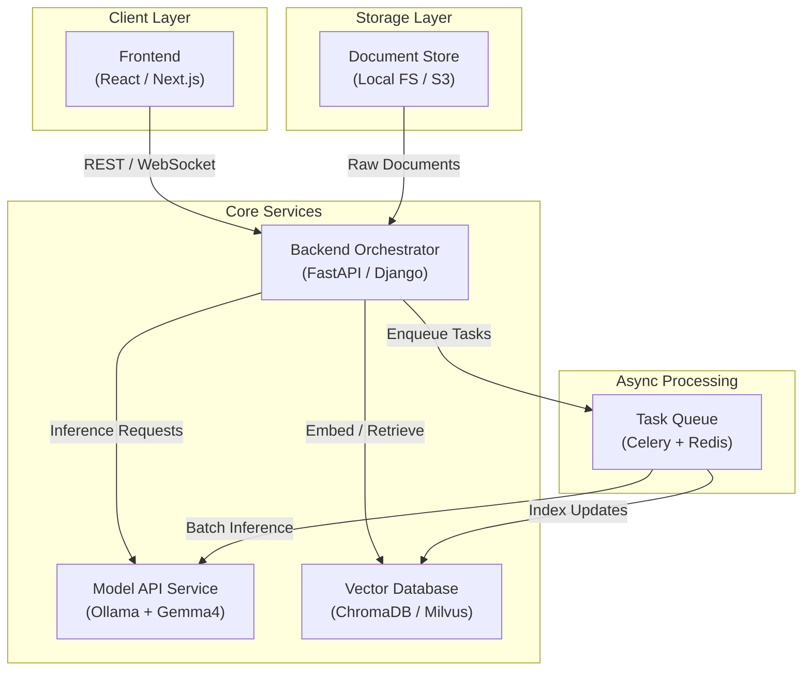
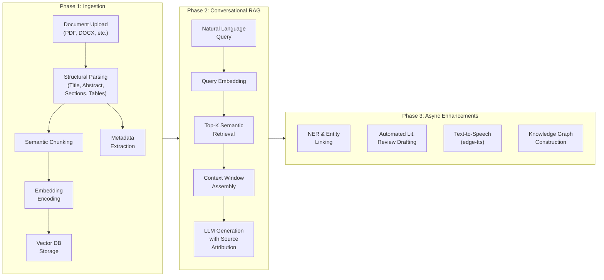

# Research Canvas: A Privacy-Preserving, RAG-Powered Intelligent Research Assistant Platform Built on Local LLM Inference and Microservice Architecture

---

## Abstract

The exponential growth of scholarly literature has created a critical bottleneck for researchers who must efficiently locate, synthesize, and leverage knowledge across vast document corpora. This paper presents **Research Canvas**, an integrated, privacy-preserving research assistance platform that combines Retrieval-Augmented Generation (RAG), Named Entity Recognition (NER), local large language model (LLM) inference, and a microservice architecture to support the full research lifecycle—from document ingestion and conversational knowledge retrieval to automated literature review generation. The system adopts a "local-first" design philosophy, deploying open-source models (e.g., Gemma4 via Ollama) to ensure that sensitive, unpublished research data never leaves the user's environment. Through JWT-authenticated isolated workspaces, asynchronous task queues, and multimodal enhancements including text-to-speech, Research Canvas addresses the dual challenges of information overload and data privacy that pervade modern academic work. This paper details the system's architecture, data flow methodology, and security mechanisms, contextualizing the design within the current landscape of AI-assisted research tools, RAG systems, and microservice-based NLP pipelines.

**Keywords:** Retrieval-Augmented Generation, Named Entity Recognition, Local LLM Inference, Microservice Architecture, Research Assistance, Privacy-Preserving AI

---

## 1. Introduction

### 1.1 Problem Context

The digitization of scholarship has yielded an unprecedented volume of accessible literature, yet this abundance paradoxically impedes research productivity. Researchers must sift through thousands of papers, extract relevant findings, reconcile conflicting evidence, and synthesize coherent narratives—tasks that are cognitively demanding and time-intensive. Traditional reference management tools (e.g., Zotero, Mendeley) excel at storage and annotation but lack deep semantic understanding. Conversely, general-purpose LLMs possess powerful natural language capabilities but suffer from hallucination, lack domain-specific grounding, and typically require transmitting data to cloud-hosted APIs—raising serious concerns about intellectual property and data privacy.

Retrieval-Augmented Generation (RAG) has emerged as a principled solution to the hallucination problem by coupling an external knowledge retrieval mechanism with the generative capabilities of LLMs, enabling responses grounded in specific source documents . Concurrently, research on AI-assisted academic writing has demonstrated that systems incorporating citation recommendation and structured introduction generation can meaningfully support scholarly workflows . Tools like IdeaSynth have further shown that LLM-based, literature-grounded feedback can support the iterative development of research ideas—from broad exploration to deep refinement—when ideas are represented as composable facets on a canvas interface .

### 1.2 Contributions

Research Canvas synthesizes these advances into a cohesive platform. The principal contributions of this work are:

1. **Local-First Privacy Architecture**: All LLM inference is performed locally via Ollama/Gemma4, ensuring that unpublished manuscripts, proprietary datasets, and sensitive experimental records never traverse external networks.
2. **End-to-End Research Lifecycle Support**: The platform covers document ingestion and parsing, conversational RAG-based retrieval with source attribution, NER-driven entity extraction, automated literature review drafting, and multimodal output (e.g., text-to-speech via edge-tts).
3. **Microservice Scalability**: A decoupled architecture comprising frontend, backend orchestrator, model API, vector database, and asynchronous task queue enables independent scaling and component replacement.
4. **Isolated Workspaces**: JWT-based authentication and project-level data isolation support concurrent multi-user, multi-project research without cross-contamination.

---

## 2. Related Work

### 2.1 Retrieval-Augmented Generation for Domain-Specific Assistants

The RAG paradigm has rapidly become the dominant approach for constructing domain-specific AI assistants that require factual accuracy and source traceability. Kristoffersson (2024) conducted a systematic evaluation of different RAG techniques and LLMs for building a custom AI assistant within the Canvas Learning Management System, demonstrating that RAG significantly enhances factual accuracy and contextual relevance compared to standalone LLM inference, and that keeping context information on local models provides important privacy advantages . Chavan (2024) compared fine-tuning, pretrained models, and RAG for web design code generation, concluding that RAG can effectively transform a generic LLM into a domain-specialized system by dynamically injecting relevant context from a curated database .

Billah and Yusof (2025) presented a systematic review exploring the role of RAG in cloud-based chatbot architectures, noting that research comparing monolithic, microservices, and hybrid architectures for RAG-based systems is still nascent but rapidly growing . Weligamage (2026) described the integration of a knowledge-grounded RAG chatbot for multi-tenant industrial troubleshooting, presenting a step-by-step generic RAG architecture that addresses tenant isolation—a concern directly analogous to the workspace isolation in Research Canvas .

### 2.2 Named Entity Recognition and Knowledge Graph Construction

Named Entity Recognition (NER) is a foundational NLP task for extracting structured knowledge from unstructured text. Lample et al. (2016) introduced two influential neural architectures for NER—one based on bidirectional LSTMs with conditional random fields, and another using a transition-based approach—achieving state-of-the-art performance across four languages without language-specific resources . Liu et al. (2022) provided a comprehensive survey of Chinese NER, reviewing the evolution from feature-engineered to deep learning-based methods . In the context of document review systems, Angelici combined NER with knowledge graphs and LLMs, demonstrating that NER serves as a critical upstream component for building structured knowledge representations from document corpora .

### 2.3 Microservice Architectures for NLP Pipelines

Microservice architecture has gained significant traction for building complex NLP systems due to its modularity, independent deployability, and fault isolation. Mecella et al. introduced a microservices-based pipeline for complex linguistic tasks that integrates NER, knowledge graphs, and a RAG microservice, demonstrating that decomposing NLP workflows into independent services improves maintainability and extensibility . Thottempudi and Borra (2024) described an intelligent agent leveraging LLMs with a microservice architecture that responds with precision and context awareness, combining RAG with multi-faceted capabilities . Sotiropoulos (2026) investigated how AI tools perform in defining microservices software architectures, exploring how RAG techniques affect the quality of AI-generated architectural designs . Khadem and Movaghar (2025) further demonstrated the alignment of DevOps practices with microservice architecture using RAG-based decision support, constructing structured datasets of concept pairs grounded in academic literature .

### 2.4 AI-Assisted Academic Writing and Research Ideation

The application of AI to scholarly writing workflows has progressed rapidly. Liebling et al. (2025) presented an AI-assisted academic writing system with two core components: citation recommendation (considering the user's current document context) and structured introduction generation that situates contributions relative to prior work. Their findings indicate strong demand for precise AI-assisted writing systems and that simple, effective methods can meet these needs .

Pu et al. (2024) introduced IdeaSynth, a research idea development system that uses LLMs to provide literature-grounded feedback for articulating research problems, solutions, evaluations, and contributions. IdeaSynth represents idea facets as nodes on a canvas, allowing researchers to iteratively refine them through variation and composition. A lab study (N=20) showed that participants explored more alternative ideas and expanded initial ideas with greater detail compared to an LLM-only baseline; a deployment study (N=7) demonstrated effective use across real-world projects at various ideation stages .

### 2.5 Structured Canvas-Based Design Methodologies

The "canvas" metaphor for structured design has been applied across multiple domains. Van Capelleveen et al. (2019) proposed the Recommender Canvas as a model for developing and documenting recommender system designs, providing a structured framework that organizes design decisions into a coherent visual format . Napoleão et al. (2020) proposed a Secondary and Tertiary Study Canvas to simplify systematic literature review protocols, synthesizing and organizing the steps into a canvas format with a step-based approach to assist review conduction—a methodology that is considered one of the most challenging phases by the software engineering research community . These canvas-based approaches directly inspire Research Canvas's workspace organization, where research materials, queries, entity graphs, and generated outputs are spatially arranged for nonlinear exploration.

### 2.6 Foundational Transformer Architecture

The entire ecosystem of modern LLMs underlying Research Canvas's generative capabilities traces to the Transformer architecture proposed by Vaswani et al. (2017), which introduced the self-attention mechanism that dispensed with recurrence and convolutions entirely. The Transformer achieved state-of-the-art results on machine translation while being significantly more parallelizable and faster to train . All local models deployed in Research Canvas (including the Gemma family) are descendants of this foundational architecture.

---

## 3. Proposed System Architecture

Research Canvas employs a microservice architecture that decomposes the system into five loosely coupled components, each independently deployable and scalable. This design aligns with emerging best practices for RAG-based NLP pipelines .

### 3.1 Frontend Interface

The React/Next.js-based frontend implements a canvas-style workspace where researchers can spatially organize documents, conversation threads, entity relation graphs, and generated drafts. This spatial arrangement supports the nonlinear, exploratory nature of research ideation—a principle validated by IdeaSynth's demonstration that canvas-based idea facet composition leads to more thorough exploration and refinement . The canvas metaphor also echoes the structured design approaches of van Capelleveen et al. (2019)  and Napoleão et al. (2020) .

### 3.2 Backend Orchestrator

The FastAPI/Django-based orchestrator serves as the central coordination hub, responsible for:
- Routing user requests to appropriate services
- Managing the RAG retrieval pipeline (query encoding → vector search → context assembly → LLM generation)
- Enforcing JWT-based authentication and workspace-level access control
- Dispatching long-running tasks to the asynchronous queue

### 3.3 Local Model API Service

A critical differentiator of Research Canvas is that all LLM inference occurs locally through Ollama hosting open-source models such as Gemma4. This directly addresses the privacy concerns documented in domain-specific RAG implementations: Kristoffersson (2024) specifically noted the advantage of keeping context information on local models , and Hutchens & Cheng (2025) similarly employed locally hosted models for their RAG-LLM ensemble framework integrated with an educational platform . The local deployment eliminates dependency on third-party APIs and ensures that proprietary research data—unpublished manuscripts, experimental results, patent drafts—remains within the researcher's controlled environment.

### 3.4 Vector Database

ChromaDB or Milvus stores dense vector embeddings of document chunks, enabling efficient approximate nearest-neighbor retrieval during RAG queries. Documents are embedded using the same local model infrastructure, maintaining the local-first guarantee. The vector database is logically partitioned by workspace to enforce isolation.

### 3.5 Asynchronous Task Queue

Celery backed by Redis handles computationally intensive and long-running operations without blocking the interactive user experience. Queued tasks include batch document ingestion, corpus-wide NER annotation, automated literature review generation, and text-to-speech synthesis via edge-tts.

---

## 4. Methodology and Data Flow

The operational pipeline is organized into three distinct phases:

### 4.1 Phase 1: Document Ingestion and Parsing

When a researcher uploads documents to a workspace, the ingestion pipeline performs:

1. **Structural Parsing**: Extraction of document hierarchy (title, abstract, section headings, body text, tables, figure captions) using rule-based and ML-assisted PDF parsing.
2. **Semantic Chunking**: Rather than fixed-length splitting, the system segments text along semantic boundaries (paragraph, section) to preserve contextual coherence within each chunk.
3. **Embedding Encoding**: Each chunk is encoded into a dense vector representation using the locally deployed embedding model.
4. **Vector Storage**: Embeddings are indexed in the vector database under the workspace's partition.
5. **Metadata Extraction**: Bibliographic metadata (authors, publication date, DOI, keywords) is extracted and stored in a structured relational store for faceted filtering.

This automated pipeline resonates with the goals of Napoleão et al.'s (2020) Study Canvas, which sought to simplify and clarify the labor-intensive protocol development steps in systematic reviews —Research Canvas automates much of this labor computationally.

### 4.2 Phase 2: Conversational RAG

The conversational RAG module constitutes the primary user interaction mode:

1. **Query Encoding**: The user's natural language question is embedded using the same model that encoded the document chunks, ensuring representational consistency.
2. **Semantic Retrieval**: The query vector is used to retrieve the Top-K most semantically similar document chunks from the vector database.
3. **Context Assembly**: Retrieved chunks are assembled into a context window, optionally augmented with conversation history for multi-turn coherence.
4. **Grounded Generation**: The local LLM generates a response conditioned on both the query and the retrieved context, with explicit source attribution linking claims to specific document passages.

This architecture directly addresses the hallucination problem by grounding every assertion in retrievable source material. Kristoffersson (2024) validated this approach empirically, showing that RAG-based assistants produce significantly more accurate domain-specific responses than standalone LLMs . The citation-aware generation further aligns with Liebling et al.'s (2025) finding that contextual citation recommendation is a key component of effective AI-assisted academic writing .

### 4.3 Phase 3: Asynchronous Enhancements

Long-running analytical tasks are offloaded to the Celery/Redis queue:

- **Named Entity Recognition and Linking**: Automated identification of key entities (researchers, institutions, methods, compounds, datasets) across the corpus. Modern neural NER architectures, building on the foundational work of Lample et al. (2016) using bidirectional LSTMs and CRFs , enable robust extraction without language-specific gazetteers. Angelici further demonstrated that NER combined with knowledge graphs enhances document review quality . Hutchens & Cheng (2025) specifically applied RAG-LLM ensembles to extract domain-specific concept maps, identifying entities and their relationships from course materials .
- **Automated Literature Review Generation**: Given the accumulated literature in a workspace, the system drafts a structured review synthesis, organizing findings thematically.
- **Text-to-Speech (edge-tts)**: Multimodal output supports auditory learning and accessibility, converting generated summaries or paper abstracts into natural speech.
- **Knowledge Graph Construction**: Entity relationships extracted via NER are organized into a navigable graph structure, enabling visual exploration of conceptual connections across the corpus.

---

## 5. Security and Privacy Architecture

Data privacy constitutes a first-order design constraint in Research Canvas. The table below summarizes the security mechanisms:

| Layer | Mechanism | Privacy Guarantee |
|-------|-----------|-------------------|
| **LLM Inference** | Ollama local deployment (Gemma4) | No data transmitted to external APIs |
| **Authentication** | JWT token-based user/project auth | Cryptographic identity verification |
| **Workspace Isolation** | Per-project vector DB partitions | Cross-project data inaccessible |
| **Document Storage** | Local filesystem (or self-hosted S3) | Physical data sovereignty |
| **Embedding Storage** | Local PostgreSQL/pgvector instance | Vector representations remain local |
| **Transport Security** | HTTPS/TLS for all client-server communication | Encrypted in-transit data |

The local-first approach is particularly critical for researchers handling pre-publication manuscripts, proprietary experimental data, or patent-sensitive information. Unlike cloud-dependent solutions where data is subject to third-party terms of service and jurisdictional uncertainties, Research Canvas ensures complete data sovereignty. This design is validated by the growing body of work emphasizing local model deployment: Kristoffersson (2024) highlighted privacy as a key advantage of keeping context on local models , and Hutchens & Cheng (2025) adopted locally hosted models specifically to protect sensitive educational data .

The JWT-based workspace isolation further ensures that in multi-user deployments (e.g., research groups or institutional installations), each researcher's data remains strictly compartmentalized—analogous to the multi-tenant isolation mechanisms described by Weligamage (2026) for industrial RAG chatbots .

---

## 6. Discussion

### 6.1 Strengths

**Privacy Guarantee.** The local-first architecture eliminates a class of risks that cloud-dependent AI tools inherently carry. For researchers in sensitive domains (defense, pharmaceuticals, pre-patent innovation), this is a prerequisite rather than a feature.

**Source Traceability.** The RAG mechanism ensures that every generated claim can be traced to a specific document passage, addressing the hallucination problem that undermines trust in standalone LLMs .

**Nonlinear Research Support.** The canvas-based workspace supports the divergent-convergent thinking patterns inherent in research, consistent with IdeaSynth's empirical findings that canvas-based idea composition fosters richer exploration .

**Architectural Modularity.** The microservice design enables independent evolution of components—a stronger embedding model can replace the current one, the vector database can be upgraded, or the LLM can be swapped—without systemic disruption .

### 6.2 Limitations

**Local Compute Constraints.** Open-source models deployable on consumer or workstation hardware (e.g., Gemma4) inevitably trail frontier commercial models (e.g., GPT-4, Claude) in complex reasoning and cross-document synthesis tasks. This performance gap may be particularly acute for multi-step logical inference over large corpora.

**Document Parsing Fidelity.** PDF parsing—especially for scanned documents, complex mathematical notation, and multi-column layouts—remains an imperfect technology. Parsing errors propagate through the entire pipeline, degrading chunk quality, embedding accuracy, and ultimately RAG retrieval relevance.

**Absence of Empirical Evaluation.** The current work presents an architectural proposal without controlled user studies or quantitative benchmarking. Formal evaluation comparing Research Canvas to existing tools (e.g., Semantic Scholar, Elicit, Consensus) on metrics such as answer accuracy, retrieval precision, user satisfaction, and task completion time is essential for validating the claimed benefits.

**Scalability of Local Deployment.** While microservice architecture provides logical scalability, the physical constraints of local hardware impose practical limits on concurrent users, corpus size, and inference throughput.

### 6.3 Future Work

1. **Hybrid Inference Mode**: Implement a user-controllable toggle between local and cloud-based inference, allowing researchers to trade privacy for performance when working with non-sensitive materials.
2. **Collaborative Workspaces**: Extend the platform to support real-time multi-user collaboration with concurrent editing, annotation sharing, and role-based access control.
3. **External Knowledge Integration**: Connect NER outputs to external knowledge bases (e.g., OpenAlex, Semantic Scholar API, Wikidata) to enrich the local knowledge graph with global scholarly metadata.
4. **Formal User Studies**: Design within-subjects experiments (following protocols similar to those used in IdeaSynth's evaluation ) to measure Research Canvas's impact on literature review quality, research efficiency, and ideation breadth.
5. **Regulatory and Translational Support**: For biomedical and translational research contexts, integrate regulatory strategy planning and commercialization pathway tools aligned with grant writing fundamentals .
6. **Advanced RAG Techniques**: Incorporate iterative retrieval, query decomposition, and re-ranking to improve retrieval precision for complex multi-faceted research questions, building on the comparative insights of Billah & Yusof (2025) .

---

## 7. Conclusion

Research Canvas presents a comprehensive, privacy-preserving platform for AI-assisted research that addresses the converging challenges of information overload, data privacy, and the need for source-grounded generation in scholarly work. By integrating local LLM inference via Ollama/Gemma4, Retrieval-Augmented Generation, Named Entity Recognition, and a modular microservice architecture, the system supports the full research lifecycle within an isolated, user-controlled environment. The canvas-based workspace design facilitates the nonlinear, iterative nature of research ideation, while asynchronous processing enables computationally intensive tasks—from corpus-wide NER to automated literature review drafting—without disrupting interactive workflows.

The platform builds upon and synthesizes advances across multiple active research fronts: RAG-based domain-specific assistants, neural NER architectures, AI-assisted academic writing, microservice NLP pipelines, and structured canvas-based design methodologies. While the current work is primarily architectural, the design decisions are grounded in empirically validated principles from the literature. Future work prioritizing formal evaluation, hybrid inference, and collaborative features will be essential to realizing the platform's full potential as a transformative tool for the research community.

---

## References

[1] L. Kristoffersson, "Evaluating Techniques for Building AI Assistants in a Specialised Domain: Comparing RAG Techniques and LLMs in Custom Built Assistant for the Canvas LMS," 2024. Available: https://www.diva-portal.org/smash/record.jsf?pid=diva2:1897037

[2] Z. Hutchens and Q. Cheng, "WIP: Automated Extraction of Domain-Specific Concept Maps Using a RAG-LLM Ensemble Framework," in *IEEE Frontiers in Education Conference*, 2025. Available: https://ieeexplore.ieee.org/abstract/document/11328309/

[3] D. J. Liebling, M. Kane, M. Grunde-McLaughlin, I. J. Lang, S. Venugopalan, and M. P. Brenner, "Towards AI-assisted Academic Writing," *arXiv preprint arXiv:2503.13771*, 2025.

[4] S. R. Chavan, "Optimizing Web Design Code Generation: A Comparative Study of Finetuning, Pretrained Models, and RAG," San Jose State University, 2024. Available: https://scholarworks.sjsu.edu/etd_projects/1456/

[5] K. Pu, K. J. K. Feng, T. Grossman, T. Hope, B. D. Mishra, M. Latzke, J. Bragg, J. C. Chang, and P. Siangliulue, "IdeaSynth: Iterative Research Idea Development Through Evolving and Composing Idea Facets with Literature-Grounded Feedback," *arXiv preprint arXiv:2410.04025*, 2024.

[6] G. van Capelleveen, C. Amrit, D. M. Yazan, and H. Zijm, "The recommender canvas: A model for developing and documenting recommender system design," *Expert Systems with Applications*, vol. 129, pp. 14–29, 2019.

[7] B. M. Napoleão, F. Petrillo, and S. Hallé, "A Tertiary and Secondary Study Canvas," *arXiv preprint arXiv:2004.01315*, 2020.

[8] A. Vaswani, N. Shazeer, N. Parmar, J. Uszkoreit, L. Jones, A. N. Gomez, L. Kaiser, and I. Polosukhin, "Attention Is All You Need," *arXiv preprint arXiv:1706.03762*, 2017.

[9] G. Lample, M. Ballesteros, S. Subramanian, K. Kawakami, and C. Dyer, "Neural Architectures for Named Entity Recognition," *arXiv preprint arXiv:1603.01360*, 2016.

[10] P. Liu, Y. Guo, F. Wang, and G. Li, "Chinese named entity recognition: The state of the art," *Neurocomputing*, vol. 473, pp. 37–53, 2022.

[11] P. Angelici, "Enhancing documents review through Knowledge Graphs and Large Language Models," M.S. thesis, 2024. Available: https://skemman.is/handle/1946/47695

[12] S. G. Thottempudi and S. Borra, "Leveraging Large Language Models to Enhance an Intelligent Agent with Multifaceted Capabilities," *Preprints*, 2024. Available: https://www.preprints.org/manuscript/202409.1446

[13] M. Mecella et al., "A service-based pipeline for complex linguistic tasks adopting LLMs and Knowledge Graphs," ResearchGate, 2024.

[14] G. Sotiropoulos, "Investigation of AI tools Performance in the Definition of Microservices Software Architectures," National Technical University of Athens, 2026.

[15] S. M. Billah and R. J. B. R. Yusof, "Exploring the Role of RAG in Cloud-Based Monolithic Chatbots: A Systematic Review," in *23rd Student Conference on Research and Development*, IEEE, 2025.

[16] E. A. Khadem and A. Movaghar, "Aligning DevOps and Microservice Architecture: Empirical Mapping, Taxonomy, and RAG-Based Decision Support," *IEEE Access*, 2025.

[17] D. Weligamage, "Integrating a Knowledge-Grounded RAG Chatbot for Multi-Tenant Industrial Machinery Troubleshooting," University of Turku, 2026.

[18] B. Poteralska, "Decision Support System in the Area of Generating Innovative Research Projects of the Future," *Procedia Engineering*, vol. 182, pp. 587–594, 2017.

[19] J. Maccarthy, S. Guerin, A. G. Wilson, and E. R. Dorris, "Facilitating public and patient involvement in basic and preclinical health research," *PLoS ONE*, vol. 14, no. 5, e0216600, 2019.

[20] "Sources of Biomedical Research Funding and Grant Writing Fundamentals," Bohrium Sciencepedia. Available: https://sciencepedia.bohrium.com/article/891480

---

